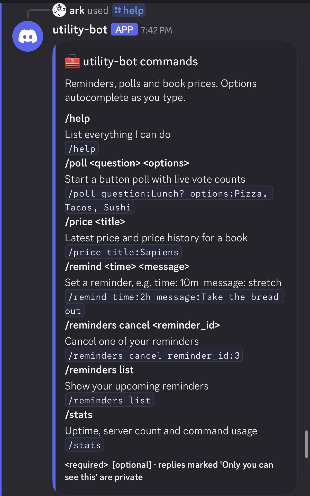
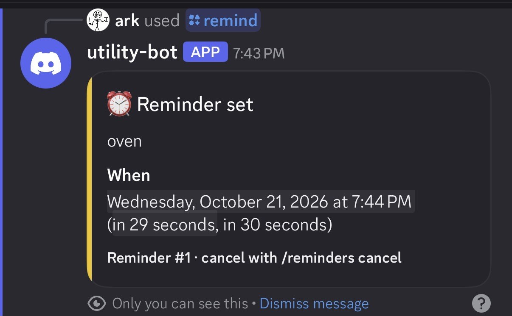
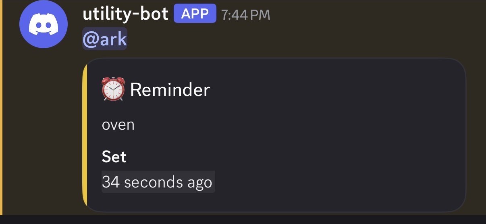
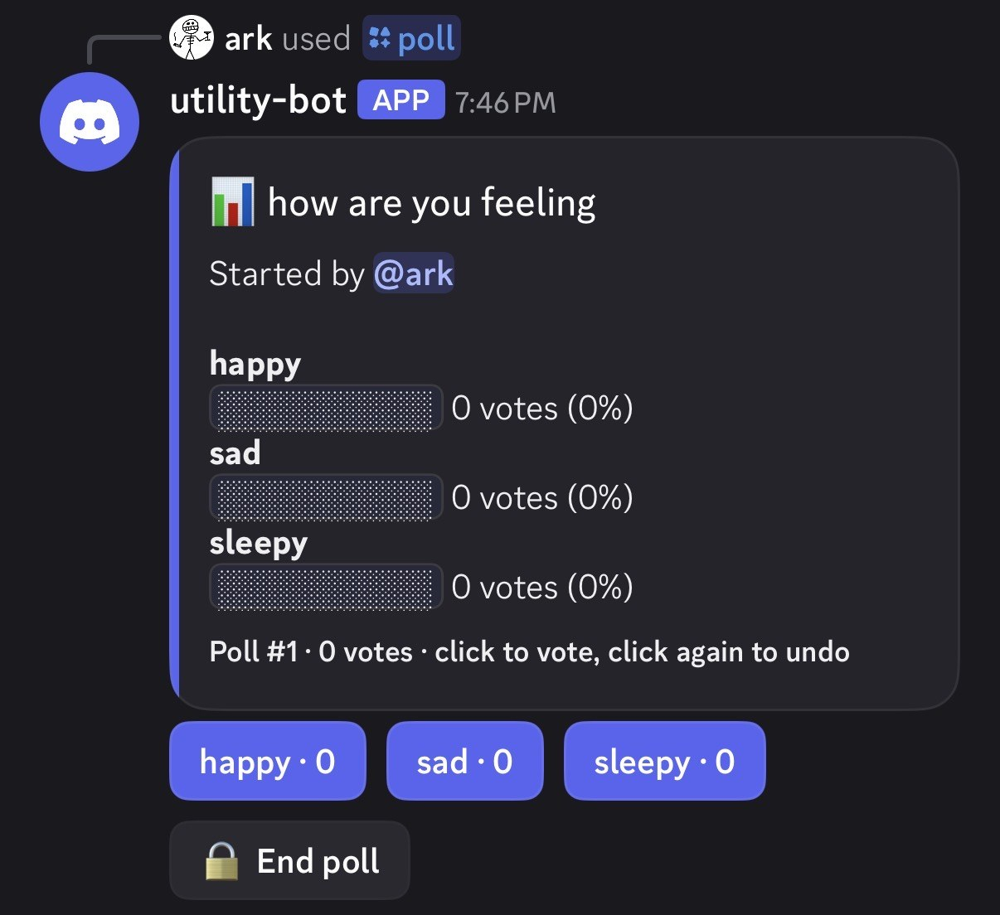
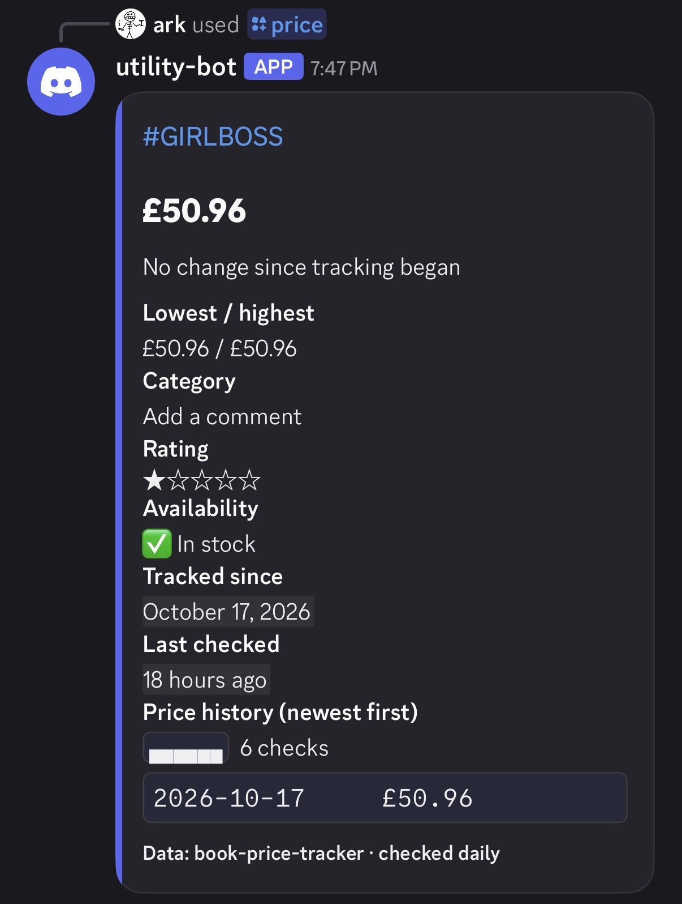
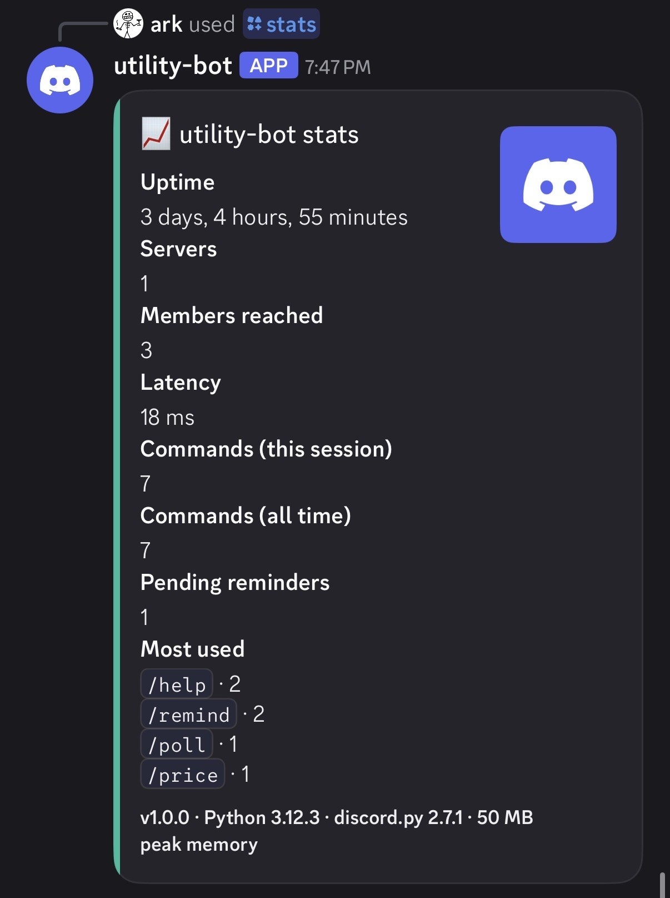
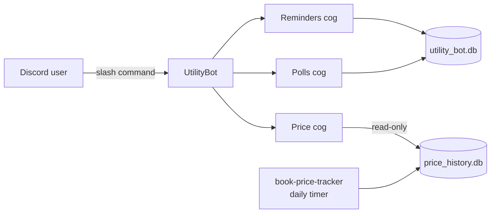

# utility-bot

A Discord bot built with Python and **discord.py** slash commands. It has reminders that survive restarts, button polls with live vote counts, and book price lookups backed by my [book-price-tracker](https://github.com/spenceco/book-price-tracker) scraper. It runs 24/7 as a hardened systemd service.

  

## Commands

| Command | What it does |
|---|---|
| `/remind <time> <message>` | Reminds you later, in the same channel. Accepts `10m`, `2h`, `1d 4h`, `1w`, `in 3 days`… |
| `/reminders list` | Your upcoming reminders (only you can see them) |
| `/reminders cancel <id>` | Cancel a reminder (autocompletes your reminders) |
| `/poll <question> <options>` | Button poll with live counts. Options go comma-separated: `Pizza, Tacos, Sushi`. Click again to undo your vote; the creator can end the poll. |
| `/price <book title>` | Latest price, change, low/high, rating, stock and a price history chart for a tracked book. Titles autocomplete and typos are forgiven. |
| `/stats` | Uptime, server count, latency, commands used (this session and all time), top commands |
| `/help` | Lists every command with an example |

## Screenshots

| /help | /remind | Reminder delivered |
|---|---|---|
|  |  |  |

| /poll | /price | /stats |
|---|---|---|
|  |  |  |

## Features at a glance

- **Reminders survive restarts.** They're stored in SQLite. A background task checks every 5 seconds, and anything that came due while the bot was offline is delivered as soon as it's back, marked "late". If the channel is gone, the reminder goes to your DMs. Pings are locked to the reminder's owner, so `@everyone` in a reminder can't ping a whole server.
- **Polls keep working after restarts.** Each button's ID encodes the poll and option (`poll:12:3`) and votes live in SQLite, so buttons on old messages still work after a redeploy. Users get one vote each: click to vote, click a different option to switch, click again to undo.
- **Price lookups are forgiving.** Matching tries an exact title first, then a substring, then a fuzzy match, so "sapeins" finds *Sapiens*. Curly and straight apostrophes match each other. The tracker's database is opened **read-only**.
- **Errors are friendly.** One error handler turns every failure into a short private message ("⏳ Slow down! Try again in 4 seconds"). Unexpected errors are logged with a full traceback and never shown to users.
- **Per-user cooldowns** on every command, and on poll button clicks.
- **The token is never logged.** It's excluded from `repr()`, and a logging filter redacts it from every log line as a safety net.
- **No privileged intents** are needed (no message content, no member list).

## Project layout

```
utility_bot/
├── __main__.py        entry point (python -m utility_bot)
├── bot.py             bot class: database, cogs, command sync, usage counting
├── config.py          settings from .env, validated
├── errors.py          friendly error messages for every command
├── logging_setup.py   console + rotating file logs, token redaction
├── cogs/              one Discord feature per file
│   ├── reminders.py   /remind, /reminders, delivery loop
│   ├── polls.py       /poll and its persistent buttons
│   ├── price.py       /price and title autocomplete
│   ├── stats.py       /stats
│   └── help.py        /help (generated from the registered commands)
└── core/              plain Python, no Discord: this is what the tests cover
    ├── database.py    SQLite schema
    ├── reminders.py   reminder storage
    ├── polls.py       option parsing, voting rules, tallies
    ├── prices.py      read-only price-tracker queries + fuzzy search
    ├── timeparse.py   "1h30m" → timedelta
    ├── usage.py       command usage counter
    └── formatting.py  bars, sparklines, stars, durations
tests/                 pytest suite (70 tests)
deploy/                systemd unit + install script
```



## Setup

### 1. Create the bot in Discord

1. Open the [Discord Developer Portal](https://discord.com/developers/applications) and click **New Application**. Name it `utility-bot`.
2. Under **Bot**, click **Reset Token** and copy the token. Treat it like a password.
3. Still under **Bot**, leave all three **Privileged Gateway Intents** off. This bot doesn't need them.
4. Under **General Information**, copy the **Application ID**.

### 2. Invite it to your server

Open this link with your Application ID filled in:

```
https://discord.com/oauth2/authorize?client_id=YOUR_APPLICATION_ID&permissions=84992&scope=bot+applications.commands
```

`84992` grants only what the bot uses: **View Channels**, **Send Messages**, **Embed Links** and **Read Message History**. The `applications.commands` scope lets it register slash commands. (The bot also prints its exact invite link in the log when it starts.)

### 3. Run it locally

```bash
git clone https://github.com/spenceco/utility-bot.git
cd utility-bot
python3 -m venv .venv && source .venv/bin/activate
pip install -e ".[dev]"
cp .env.example .env        # then paste your token into .env
python -m utility_bot
```

Global slash commands can take a few minutes to appear the first time. While developing, set `DEV_GUILD_ID` in `.env` to your server's ID so they show up instantly there.

| Setting | Default | Purpose |
|---|---|---|
| `DISCORD_TOKEN` | — (required) | Bot token |
| `PRICE_DB_PATH` | `/home/ubuntu/price-tracker/data/price_history.db` | book-price-tracker database |
| `BOT_DB_PATH` | `data/utility_bot.db` | Reminders, polls, usage counts |
| `LOG_LEVEL` | `INFO` | `DEBUG`, `INFO`, `WARNING`… |
| `LOG_DIR` | `logs` | Rotating log files (1 MB × 5) |
| `DEV_GUILD_ID` | unset | Sync commands to one server instantly |
| `CURRENCY_SYMBOL` | `£` | books.toscrape.com prices are in GBP |

### 4. Run the tests

```bash
pytest
```

The tests cover time parsing, reminder storage (including surviving a reconnect), poll voting rules, price search against a throwaway database, config validation, token redaction, error messages, and a smoke test that loads every cog and checks `/help` lists them all.

## Deploying 24/7 (systemd)

On the server (Ubuntu, user `ubuntu`, project in `~/utility-bot`):

```bash
bash deploy/set-token.sh             # prompts for the token (hidden), then installs + starts the service
journalctl -u utility-bot -f         # live logs
```

The unit file ([`deploy/utility-bot.service`](deploy/utility-bot.service)):

- **restarts on failure** after 10 seconds, giving up only after 10 crashes in 5 minutes,
- **doesn't restart-loop on a bad token**: exit code 2 means a config problem, so systemd stops instead of retrying,
- shuts down cleanly on `SIGTERM`,
- runs with a **read-only filesystem** except for its own `data/` and `logs/` folders.

Useful commands: `sudo systemctl restart utility-bot`, `systemctl status utility-bot`.

## License

MIT
